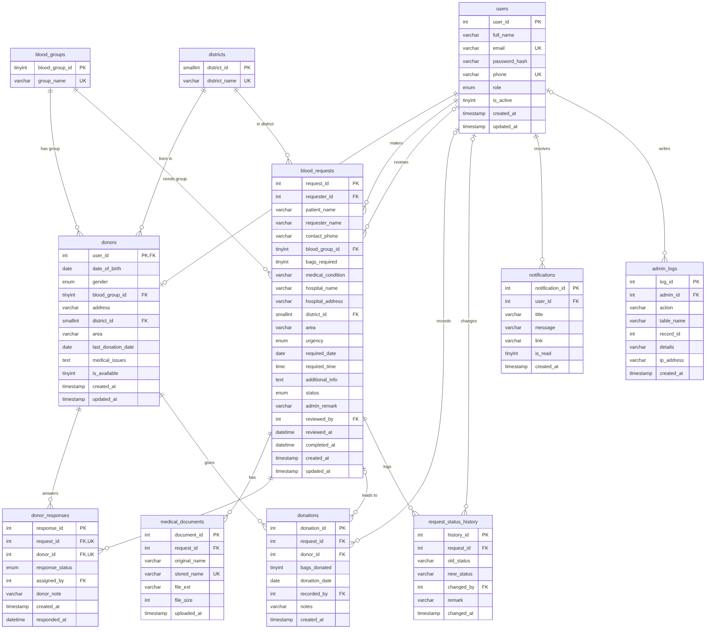

# BloodBank – Blood Donation and Blood Request System

BloodBank is a website that helps people **find blood** and helps people **give blood**.
A family that needs blood sends a request. An **admin checks** the request. Then donors who match are asked to help.

This is a group project for **ICE 3324: Database Management Lab** (Database-Driven Application Development).

> **Important:** BloodBank does **not** decide if a person is medically fit to donate. It only shows reminders.
> A doctor must decide that.

---

## 1. What problem does it solve?
When a patient needs blood urgently, the family usually calls many people and posts on social media.
Nobody checks if the request is real, and nobody keeps a record.

BloodBank puts everything in one place:
- the request is **checked by an admin**,
- the right donors are **matched by blood group and district**,
- everyone can see the **status** of the request, from *Pending* to *Completed*.

## 2. Who uses it?
| User | What they can do |
|---|---|
| **Visitor** (not logged in) | Read the home page. Search donors by blood group and district. Phone numbers stay hidden. |
| **Donor** | Keep a profile. Switch availability on or off. Accept or decline requests. See notifications and donation history. |
| **Requester** | Send a blood request with a medical document. Follow their own requests by status. See when a donor accepts. |
| **Admin** | Review requests. Approve or reject them. Ask donors to help. Record donations. Manage users. Read and print reports. Export the donor list. |

## 3. Main features
- **Request workflow:** Pending → Under Review → Approved → Donor Matched → Completed.
  A request can also be Rejected or Cancelled. Every change is saved in a history, and only an admin can mark a request *Completed* (after the blood was really given).
- **Donor matching:** by blood group and district. A donor can accept, decline, volunteer or withdraw.
- **Notifications:** short messages inside the website for donors, requesters and admins.
- **Secure medical documents:** only PDF, JPG or PNG. The real file type and size are checked. Files get random names. Only the owner and the admin can open them.
- **Reports for the admin:** totals, requests by status, blood needed against donors available, busiest districts, top donors. The page can be printed.
- **Safe by design:** hashed passwords, prepared statements, escaped output, CSRF tokens, role checks, login lock after 5 wrong tries, automatic logout when idle, and an admin activity log.

## 4. Technology
| Part | What we used |
|---|---|
| Frontend | HTML5, CSS3, JavaScript, Bootstrap 5 |
| Backend | Core PHP 8 (using PDO) |
| Database | MySQL / MariaDB, managed with phpMyAdmin |
| Server | Apache (XAMPP) |
| Tools | VS Code, Git, GitHub |

We did not use any framework (no React, Laravel or Node). This keeps the code easy to read and explain.

## 5. The database (the most important part)
The database is called `bloodbank`. It has **11 tables**, **18 foreign keys**, **3 views**, **2 triggers** and **1 stored procedure**.

| Table | What it stores |
|---|---|
| `users` | Everyone who can log in (admin, donor, requester). Passwords are stored as hashes. |
| `donors` | Extra details of a donor: blood group, district, area, availability, last donation. |
| `blood_groups` | The 8 blood groups (A+, A-, B+, B-, AB+, AB-, O+, O-). |
| `districts` | The 64 districts of Bangladesh. |
| `blood_requests` | Every blood request and its current status. |
| `medical_documents` | The uploaded document of a request (only the file name, not the file). |
| `donor_responses` | Which donor was asked for which request, and the answer. (Links donors and requests: many-to-many.) |
| `donations` | Every donation that really happened. |
| `request_status_history` | The full timeline of each request. |
| `notifications` | Messages shown to users. |
| `admin_logs` | What the admin did (audit trail). |

Smart parts of the database:
- **Trigger** `trg_donation_update_last_date`: when a donation is saved, the donor's *last donation date* updates by itself.
- **Trigger** `trg_donation_before_insert`: stops a donation with a future date.
- **Views:** `v_request_overview`, `v_donor_directory`, `v_blood_group_summary`.
- **Stored procedure** `sp_matching_donors(request_id)`: lists donors who fit a request.
- **Transactions with `SELECT ... FOR UPDATE`:** two people cannot change the same request at the same moment.
- **Constraints and indexes:** `CHECK`, `UNIQUE`, foreign keys and 26 indexes keep the data correct and fast.

Design documents:
[ER diagram](docs/ER_DIAGRAM.md) · [Relational schema](docs/RELATIONAL_SCHEMA.md) · [Design notes](docs/DATABASE_DESIGN.md) · [Where each SQL topic is shown](docs/SQL_REQUIREMENTS_MAP.md)



## 6. SQL we demonstrate
All demo queries are in two files. Open phpMyAdmin → click `bloodbank` → **SQL** → paste a part → **Go**.
- `database/queries_demo.sql` – the basics: CREATE, INSERT, UPDATE, DELETE, SELECT, WHERE, ORDER BY, JOIN, GROUP BY, HAVING, COUNT, SUM, AVG, subqueries, view, trigger.
- `database/advanced_queries.sql` – ALTER, LIKE, MIN/MAX, RIGHT JOIN, correlated subquery, EXISTS, stored procedure, transactions and more.

## 7. How to run it on your computer

### Step 1 – Install and start XAMPP
1. Install **XAMPP**.
2. Open the XAMPP Control Panel. Click **Start** next to **Apache** and **MySQL**. Both must turn green.

### Step 2 – Get the code
Open VS Code → Terminal, go to the XAMPP folder, and clone the project. **The folder must be named `BloodBank`.**
```
cd C:\xampp\htdocs
git clone https://github.com/CAPTANIOUS/Blood-Bank.git BloodBank
```
The last word (`BloodBank`) makes Git name the folder `BloodBank` instead of `Blood-Bank`. The website needs that name.

You can also click **Code → Download ZIP** on GitHub, then unzip and rename the folder to `BloodBank`.

### Step 3 – Create the database
1. Open `http://localhost/phpmyadmin`.
2. Click **Import** → **Choose file** → select `C:\xampp\htdocs\BloodBank\database\bloodbank.sql`.
3. Scroll down and click **Import**. You will see the database `bloodbank` on the left.

(The script creates the database by itself. Importing it again deletes and re-creates everything. That is the "reset".)

### Step 4 – Open the website
Go to **http://localhost/BloodBank/**

### Test accounts (for testing only)
| Role | Email | Password |
|---|---|---|
| Admin | `admin@bloodbank.com` | `Admin@123` |
| Donor | `rahim@example.com` | `Donor@123` |
| Requester | `farhana@example.com` | `Requester@123` |

Tip: to try three roles at once, use Chrome, a Chrome private window and Edge. (Private windows of the same browser share the login.)

### If something goes wrong
| Problem | Fix |
|---|---|
| "Cannot connect to the database" | Start **MySQL** in XAMPP. Check that you imported `bloodbank.sql`. |
| Page not found or no style | The folder name must be exactly `BloodBank`, inside `htdocs`. |
| Import shows a few red "#1046 No database selected" boxes | Harmless. Check that the database `bloodbank` appears on the left. |
| Uploading a document fails | Use a PDF, JPG or PNG smaller than 5 MB. |

### Before a live demo
1. In `config/config.php` change `APP_DEBUG` to `false`.
2. Import `database/bloodbank.sql` again so the data is clean.
3. Delete the files inside `uploads/medical_documents/` (keep the folder).

## 8. Folder map
```
BloodBank/
├── config/        settings and the database connection
├── includes/      shared code: security, helper functions, page layout, workflow rules
├── assets/        CSS, JavaScript and Bootstrap
├── donor/         pages for donors
├── requester/     pages for requesters
├── admin/         pages for the admin
├── database/      bloodbank.sql, queries_demo.sql, advanced_queries.sql
├── docs/          ER diagram, schema, design notes, test checklist, viva notes
├── uploads/       medical documents (private, blocked from the browser)
└── *.php          public pages: home, about, login, register, find donors, document viewer, 404
```

## 9. Known limits (we are honest about them)
- Notifications appear inside the website only. We do not send email or SMS.
- Matching uses the exact blood group, not compatible groups.
- There is no "forgot password" page. Only a logged-in person can change their own password.
- The admin checks medical documents by eye. The system does not read them.

## 10. Documentation
[Test checklist](docs/TEST_CHECKLIST.md) · [Viva notes](docs/VIVA_NOTES.md) · [Presentation outline](docs/PRESENTATION_OUTLINE.md) · [Setup guide](docs/README.md) · [Git and GitHub guide](docs/GITHUB_GUIDE.md) · [Team contribution](docs/TEAM_CONTRIBUTION.md)

## 11. Team
| Member | GitHub | Part we built |
|---|---|---|
| Nazmul Ahmed Fahim | [@CAPTANIOUS](https://github.com/CAPTANIOUS) | Database, settings, login and security, workflow rules, document upload checks, public pages |
| Jannatul Mawoa | [@disha-0424](https://github.com/disha-0424) | Donor module, Find Donors, donor administration, ER diagram and schema |
| Amena Khatun | [@tonni-048](https://github.com/tonni-048) | Design theme, request form, requester pages, admin request screens, reports |

The list of files for each member is in [docs/TEAM_CONTRIBUTION.md](docs/TEAM_CONTRIBUTION.md).
Every member's work is visible in the **Commits** and **Pull requests** tabs of this repository.

## 12. Version
**v1.1** – the first full version plus upgrades: idle logout, password strength bar, live home page numbers, custom 404 page, advanced SQL demo, donor CSV export, donation history cards, reports from a view and a print button.
