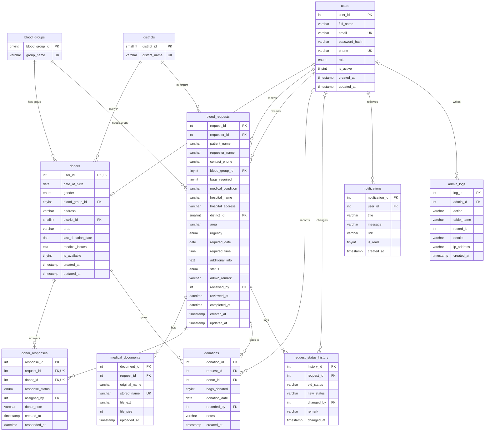

# BloodBank – Entity-Relationship (ER) Diagram

**What it is:** a picture of the database. Each box is a **table** (entity). Each line is a **relationship**.
**Why we need it:** it shows how the data is organised before anyone writes code, and the course asks for it (ICE 3324, section 2.4).

Reading the symbols (crow's foot notation):

| Symbol | Meaning |
|---|---|
| `\|\|` | exactly one |
| `o\|` | zero or one |
| `o{` | zero or many |
| **PK** / **FK** / **UK** | primary key / foreign key / unique key |

GitHub draws the diagram above by itself. A picture for the slides is in `docs/er_diagram.png`.

## How to explain the relationships (simple English)
| Relationship | Type | In words |
|---|---|---|
| users – donors | one-to-one | A donor account has exactly one donor profile. The profile uses the **same id** as the user (`donors.user_id` is both PK and FK). |
| users – blood_requests | one-to-many | One requester can make many requests. |
| blood_groups / districts – donors / blood_requests | one-to-many | One group (or district) is used by many donors and many requests. These are **lookup tables**: the name is stored once. |
| blood_requests – medical_documents | one-to-many | One request can have up to 3 uploaded documents. |
| blood_requests – donors (through `donor_responses`) | **many-to-many** | One request can ask many donors, and one donor can be asked for many requests. `donor_responses` is the **junction table**; (request_id, donor_id) is unique. |
| blood_requests – donations | one-to-many | A completed request can have several donations (several donors or bags). |
| blood_requests – request_status_history | one-to-many | Every status change is saved as a new row: this is the audit trail. |
| users – notifications / admin_logs | one-to-many | Messages for a user; actions done by an admin. |

Links not drawn, to keep the picture clear: `donor_responses.assigned_by`, `donations.recorded_by` and `blood_requests.reviewed_by` point to the admin in `users`.
The three views (`v_request_overview`, `v_donor_directory`, `v_blood_group_summary`) are not tables, so they are not in the diagram.
